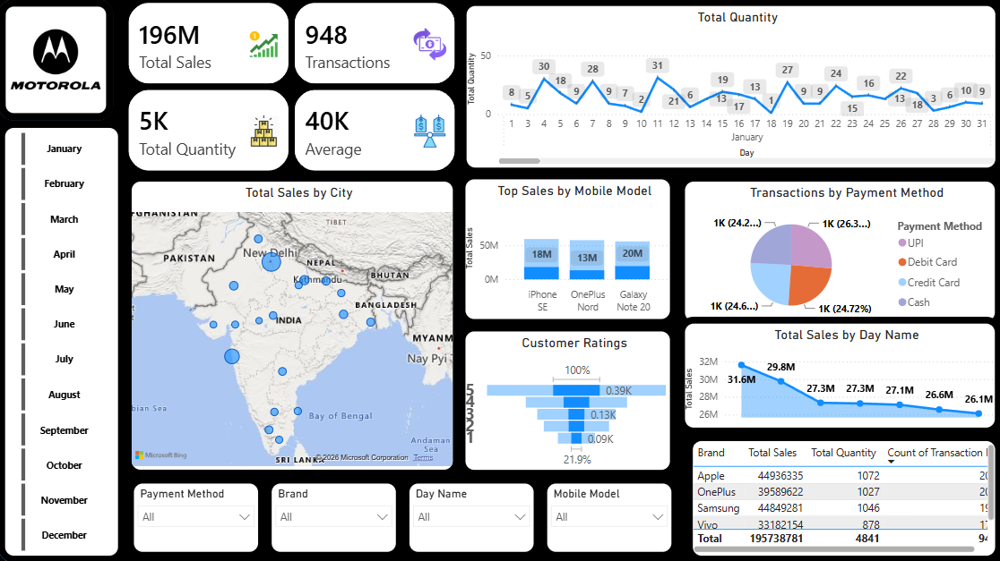

# 📱 Mobile Sales Data Analysis Dashboard | Power BI

An interactive Power BI dashboard for analyzing mobile phone sales performance, customer ratings, payment preferences, and city-wise sales distribution.

## 📌 Project Overview

The **Mobile Sales Data Analysis Dashboard** is a business intelligence project built using Power BI to explore mobile sales data and present key business metrics through interactive visualizations.

The dashboard provides an overview of sales performance across mobile brands and models, transaction patterns, customer ratings, payment methods, and geographic locations.

The objective is to turn raw sales data into actionable insights that help businesses understand product performance, customer preferences, and sales distribution.

## 🎯 Project Objectives

- Analyze overall sales performance and transaction volume.
- Compare sales across mobile brands and models.
- Identify sales distribution across different cities.
- Understand customer preferences for different payment methods.
- Analyze customer ratings and their distribution.
- Explore sales patterns across days of the week.
- Build an interactive dashboard for business reporting and decision-making.

## 🛠️ Tools & Technologies

| Tool | Purpose |
|---|---|
| Microsoft Power BI | Dashboard development and data visualization |
| Power Query | Data transformation and preparation |
| DAX | KPI measures and calculations |
| Microsoft Excel | Source dataset |

## 📊 Dashboard Preview



## 📈 Dashboard Features

### 1. Key Performance Indicators (KPIs)

The dashboard includes KPI cards for monitoring:

- **Total Sales:** Overall recorded sales value.
- **Total Transactions:** Number of transactions.
- **Total Quantity:** Total quantity of mobile units sold.
- **Average:** Average metric displayed on the dashboard.

These indicators provide a quick overview of the business's sales performance.

### 2. Sales Analysis by Brand and Mobile Model

- Compare total sales across mobile brands.
- Analyze the performance of individual mobile models.
- Identify products contributing significantly to recorded sales.

### 3. City-Wise Sales Analysis

The map visualizes the geographic distribution of mobile sales across cities, helping users explore regional sales patterns.

### 4. Payment Method Analysis

The payment method chart compares transactions made using:

- UPI
- Debit Card
- Credit Card
- Cash

This helps visualize the distribution of payment preferences.

### 5. Customer Ratings Analysis

The customer ratings visual presents the distribution of ratings, helping users explore customer feedback patterns.

### 6. Sales by Day Name

The dashboard compares sales across days of the week to explore differences in sales activity throughout the week.

### 7. Interactive Filters

The dashboard includes slicers for:

- Month
- Payment Method
- Brand
- Day Name
- Mobile Model

These filters allow users to explore the data from different perspectives and focus on specific business segments.

## 🔍 Business Questions Explored

This project helps investigate the following questions:

1. What is the total sales value and transaction volume?
2. Which mobile brands generate the highest sales?
3. Which mobile models perform best in terms of sales?
4. How are mobile sales distributed across cities?
5. Which payment methods are most frequently used?
6. How are customer ratings distributed?
7. How does sales performance vary across days of the week?
8. How do sales metrics change when different dashboard filters are applied?

## 📁 Repository Structure

```text
Model-Sales-Data-/
│
├── Day - 30 - Mobile Sales Data.xlsx
├── motorola_dashboard_Pbi.png
└── README.md
```

- `Day - 30 - Mobile Sales Data.xlsx` — Source dataset.
- `motorola_dashboard_Pbi.png` — Power BI dashboard screenshot.
- `README.md` — Project documentation.

## 🚀 How to Explore the Project

1. Clone or download this repository.
2. Open the Excel workbook to inspect the source data.
3. Open the Power BI report if the `.pbix` file is available.
4. Explore the dashboard visuals and use the available slicers to analyze different sales segments.

**Note:** The current repository contains the dataset and dashboard screenshot. To make the report fully reproducible, upload the Power BI `.pbix` file as well.

## 💡 Business Value

This dashboard demonstrates how interactive business intelligence tools can help users:

- Monitor important sales KPIs.
- Compare brand and model performance.
- Explore geographic sales distribution.
- Understand payment method preferences.
- Examine customer rating patterns.
- Support data-driven sales and marketing decisions.

The dashboard highlights patterns in the available data; further investigation would be required to establish the reasons behind those patterns.

## 🔮 Future Improvements

- Add month-over-month sales growth analysis.
- Include additional comparisons of brand and model performance.
- Create more detailed customer rating analysis.
- Add drill-through pages for product and geographic analysis.
- Publish the dashboard through Power BI Service, where appropriate.
- Document verified business insights with supporting figures.

## 👨‍💻 Author

**Shankar Dixit**

Aspiring Data Analyst | Power BI | SQL | Python

GitHub: [Shankar112004](https://github.com/Shankar112004)

---

⭐ If you find this project useful, feel free to explore the repository and share your feedback.
